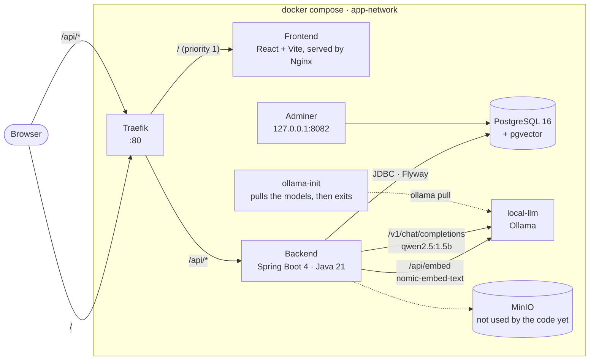
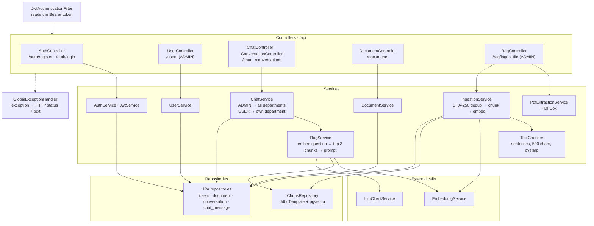
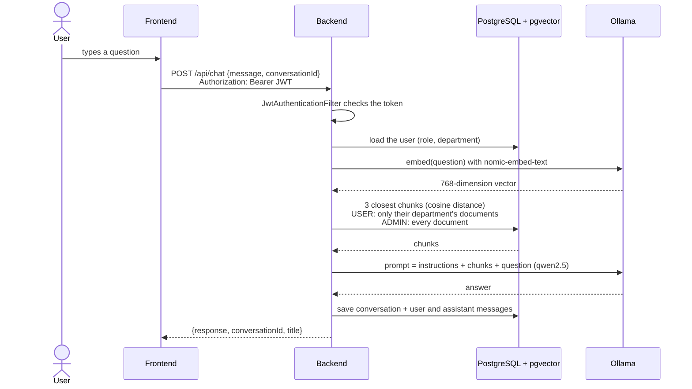
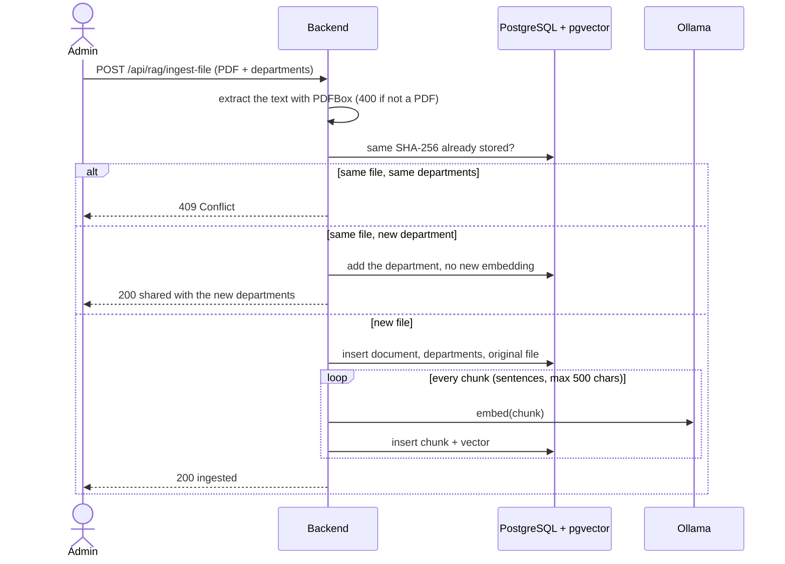
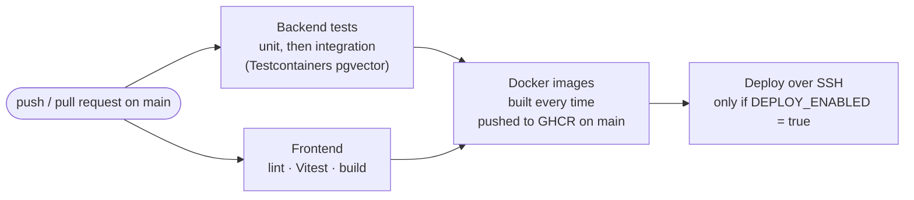

# QuadGPT architecture

## Containers

Everything runs with `docker compose`. Only Traefik is exposed on port 80; the other
ports are bound to `127.0.0.1` for local development.

## Backend layers

## Asking a question (RAG)

## Uploading a document (ADMIN)

## CI/CD

