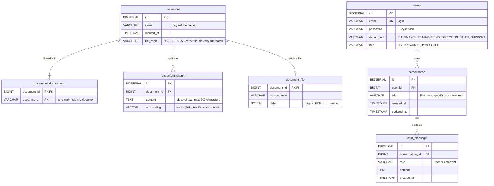

# QuadGPT database

PostgreSQL 16 with the `pgvector` extension. The schema is created by the Flyway
migrations in [backend/src/main/resources/db/migration](../backend/src/main/resources/db/migration)
(`V1` to `V5`); Hibernate never changes it (`ddl-auto: none`).

## Rules enforced by the schema

| Rule | How |
|---|---|
| One account per email | `users.email` is `UNIQUE` |
| The same file is never stored twice | unique index `uq_document_file_hash` on `document.file_hash` |
| Deleting a document removes its departments, chunks and file | `ON DELETE CASCADE` on the three foreign keys |
| Deleting a user removes their conversations and messages | `ON DELETE CASCADE` on `conversation.user_id` and `chat_message.conversation_id` |
| Vector search stays fast | HNSW index `document_chunk_embedding_idx` with `vector_cosine_ops` |
| The embedding model matches the column | `vector(768)`: `nomic-embed-text` produces 768 dimensions; another model needs a new migration |

## Indexes

| Index | Table | Used by |
|---|---|---|
| `document_chunk_embedding_idx` (HNSW, cosine) | `document_chunk` | similarity search of the RAG |
| `uq_document_file_hash` (unique) | `document` | duplicate upload detection |
| `idx_users_email` | `users` | login |
| `idx_conversation_user` (`user_id`, `updated_at DESC`) | `conversation` | conversation list in the sidebar |
| `idx_chat_message_conversation` (`conversation_id`, `id`) | `chat_message` | loading a conversation |

## Department access

`document_department` is the only link between documents and departments:

- a **USER** only searches and downloads documents with a row for their department;
- an **ADMIN** searches and downloads every document;
- a document shared with several departments has one row per department, and its chunks
  are stored only once.
